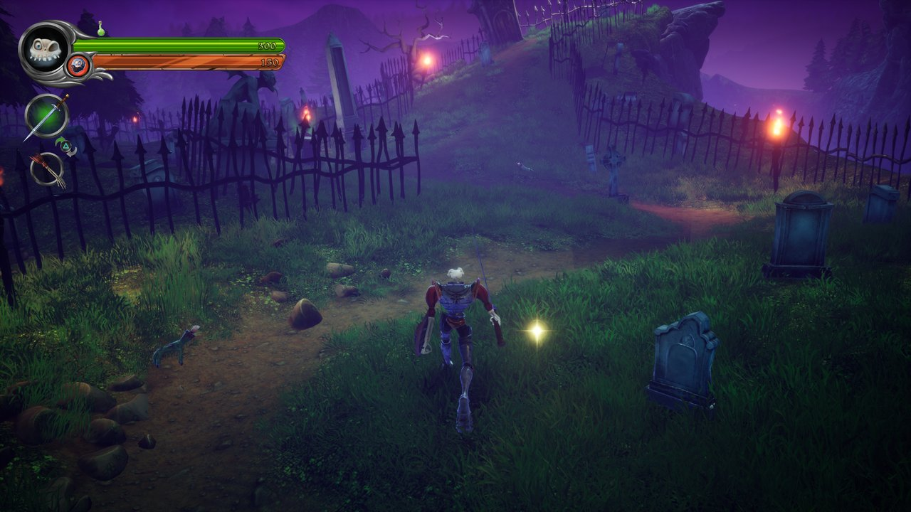
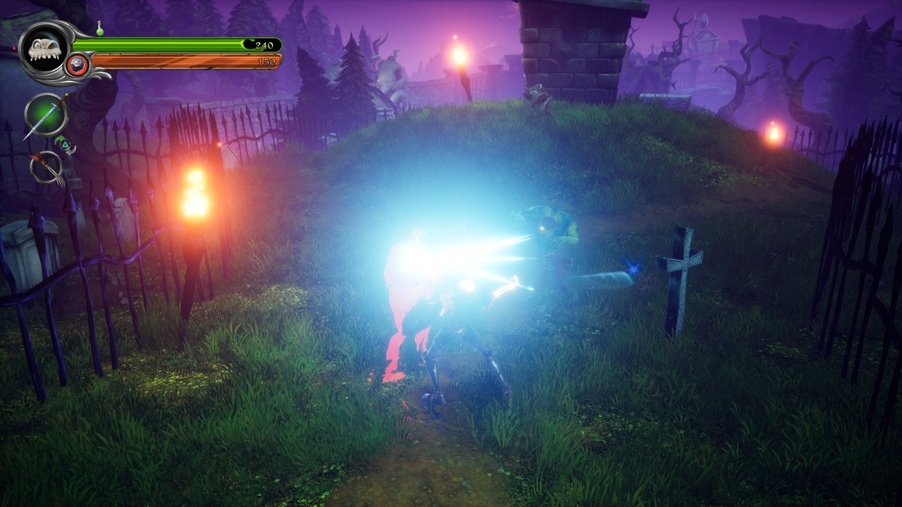
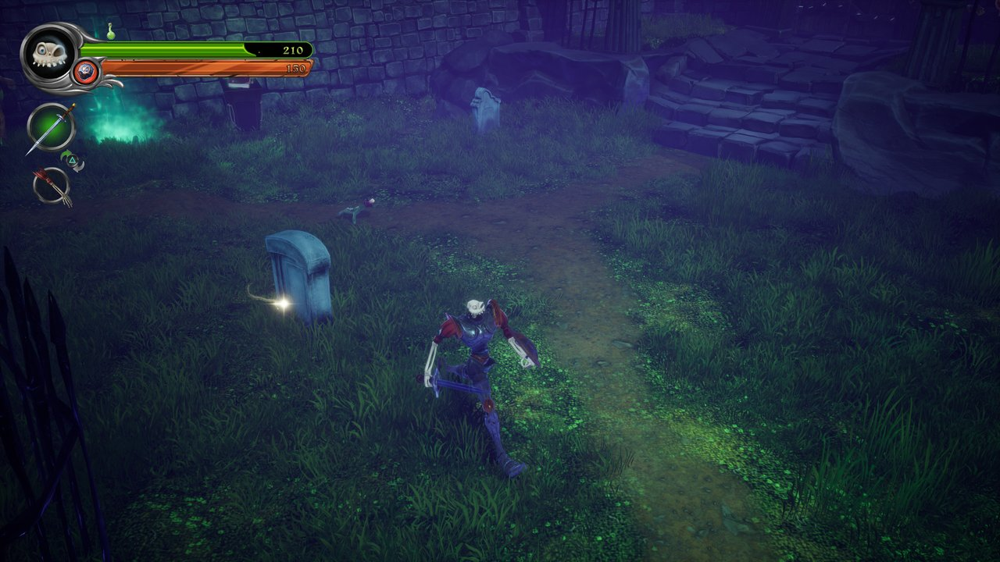
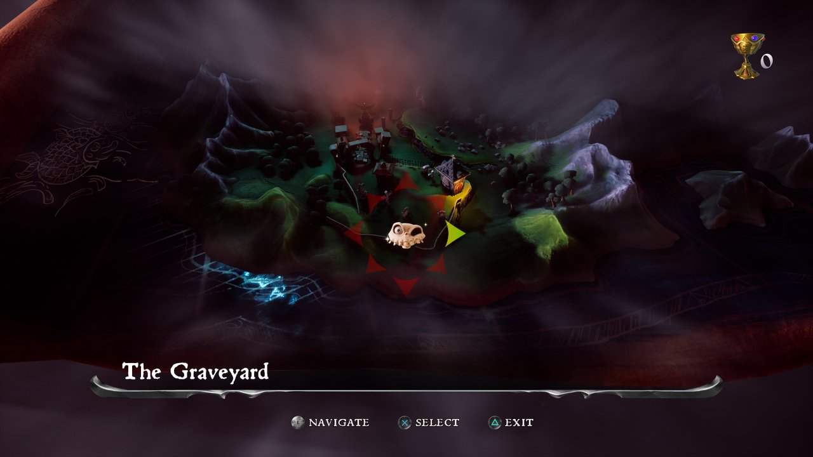

# MediEvil (PS4) for PC

A PC port of **MediEvil** (PlayStation 4, 2019, CUSA11227) for Windows 10 and 11, built on the
[God of War III PC port](https://github.com/FelipePrado0/gow3_pc).

The CPU side is native: the game's original x86-64 executable runs directly on the PC's processor
and a runtime written for this port replaces the PS4 system libraries, so there is no emulator.
The graphics run on the [shadPS4](https://github.com/shadps4-emu/shadPS4) video core, which
translates the PS4 GPU commands and shaders to Vulkan.

> **No game files are included.** You need your own copy of MediEvil (CUSA11227), as an unpacked
> folder or a fake package (.pkg). This project is not affiliated with Sony Interactive
> Entertainment or Other Ocean. MediEvil is a trademark of Sony Interactive Entertainment.

## Screenshots

| | |
|---|---|
|  |  |
|  |  |

Captured on Windows 11 (RTX 5080) with this port.

## What works

- Boot, intro movies, menus and gameplay (tested on an RTX 5080, a 1080p 200 Hz monitor and a 4K TV).
- **Above 60 FPS**: Engine frame rate 120 or 240 (launcher > Performance, or the in-game menu) lifts
  the PS4 game's 60 FPS cap. The cap is Unreal Engine 4's console frame-rate ceiling
  (`SmoothedFrameRateRange`, applied with VSync on), raised by the config override pak; game speed
  stays normal. Frames are shown as soon as they are ready (a 480 Hz virtual vblank with a frame
  limit), so pacing stays even. An RTX 5080 runs menus at 120 and levels at about 90 to 120 FPS.
- Audio (Wwise through AudioOut, ATRAC9 and AAC).
- Controller (DualSense, Xbox and others, through SDL3) and keyboard, both remappable.
- Saving and loading; save backups before every start.
- **Install from PKG**: the launcher (or `run.py`) unpacks a fake PKG once, resumably.
- **Render resolution up to 4K**: the 3D scene is drawn at up to 3840 × 2160 and scaled to the
  game's 1080p picture (a UE4 config override pak, `scripts/ue4_override.py`): sharpest on a
  1080p screen.
- **Native output 720p, 1440p, 1800p and 4K** (for 1440p/4K monitors and TVs): the game itself
  switches to that size a few seconds after start, through its own `r.SetRes` console variable.
  The in-game menu (Performance > Game resolution now) switches between 1080p, 1440p, 1800p and
  4K at any time. Native 4K needs a larger PS4 framebuffer pool: the built-in patch
  `patches/MediEvil.xml` ("Native 4K framebuffer pool (512 MB)", on by default) raises it from
  128 MB.
- **Temporal upscaling** (launcher > Performance > Upscaling): the game's own UE4 temporal
  upsampling renders the 3D scene at 67%, 58% or 50% and rebuilds the full picture from its
  motion vectors, for native output and slower graphics cards.
- **Graphics quality**: Low (integrated graphics such as the Radeon 780M), Medium, Console (PS4),
  High and Ultra (sharper, longer-range shadows, better reflections and more distant detail).
  Every preset keeps point/spot light shadows at one fixed size, which stops the shadow flicker
  while moving, and limits shadow draws so busy outdoor scenes stay near 60 FPS.
- **Launcher** in MediEvil's colors: home with cover art and quick settings, display, performance,
  game folder / PKG install / save backups, patches, mods, controls, diagnostics and log.
- **In-game menu** (Insert, or R3+L2): image (display mode, VSync, FSR 1, sharpening),
  performance and the performance overlay.
- Online features (PSN) answer as a console that is not signed in.

### Cheats (launcher > Game > Cheats)

- **Developer cheat menu**: MediEvil's own debug menu, left in the game by its developers and
  switched on by the override pak. Press **R3** while playing: unlock all levels, level select,
  complete level, unlock all weapons, invincibility, all runes and quest items, life bottles,
  gold, chalices, fly mode and more. Its 60 FPS lock is removed.
- **Unlimited ammo**: daggers, crossbow and longbow bolts, lightning and the other weapons never
  run out (weapons and shields also stop wearing out).

### Performance work in this port

- Texture cache images share VMA memory blocks instead of one driver allocation each (Unreal
  Engine 4 reuses render target memory every frame): 22% of the draw recording thread was spent
  creating and freeing GPU memory.
- A sampling profiler for the GPU threads: `GOW3_SAMPLE_FILE=<prefix>` and
  `scripts/symbolize_samples.py`.

### Known limits

- Above 60 FPS, the busiest levels are limited by the port's GPU command translation (one thread).
- After a live resolution change the debug menu's gamepad navigation cannot reach its right-hand
  column: switch to 1080p (in-game menu > Performance) to use the cheats, then back.
- All patches and cheats are for MediEvil 01.00 (the base game, CUSA11227); do not install the
  01.02 update.
- FSR 3 frame generation is planned (needs the game's motion vectors and depth).
- Experimental PS4 Pro mode (`GOW3_NEO=1`) stops in the texture cache.

## Download and play

1. Download `medievil-windows.zip` from the
   [Releases page](../../releases/latest) and extract it (not inside the zip).
2. Open **`MediEvil.exe`** (Windows may warn that it is not signed: More info, Run anyway).
3. On **Game**, either **Choose .pkg…** to install from your package, or **Browse…** to the
   folder with `eboot.bin`.
4. Choose a **Render resolution** on **Home** and press **PLAY**.

`Play MediEvil.exe` starts the game with the saved settings, for shortcuts and Steam.
More in [packaging/windows/README-Windows.txt](packaging/windows/README-Windows.txt).

## Building from source

1. Install [MSYS2](https://www.msys2.org) and, in the **MSYS2 CLANG64** shell, the packages listed
   in [packaging/windows/README.md](packaging/windows/README.md). Install
   [Python 3](https://www.python.org) with `pip install pillow cryptography`.
2. Build (newer CLANG64 toolchains need the standard headers forced for some third-party code):

   ```bash
   git clone --recursive https://github.com/bc160201983/medievil_2019_pc_port
   cd medievil_pc
   CXXFLAGS="-include cstdlib -include cstdio -include cwchar -include cmath -include new" bash build.sh
   ```

3. Start the launcher with `MediEvil Launcher.cmd` (or `python launcher/medievil_launcher.py`),
   or the game directly:

   ```powershell
   $env:GOW3_GAME_DIR = 'D:\path\CUSA11227'   # or the .pkg
   python run.py
   ```

4. Package: `bash packaging/windows/package.sh` builds `dist/medievil-windows.zip`.

## How it works

| Part | Where | What it does |
|---|---|---|
| PKG install | `scripts/pkg_extract.py` | Decrypts and unpacks fake PKGs (PFS, PFSC), as shadPS4 does |
| Game profiles | `scripts/game_profiles.py` | Modules to link and GPU defaults per title |
| Preparation | `scripts/` | Reads `eboot.bin`, links the game's `libc`, `libSceFios2` and `libSceNpToolkit2` |
| Loader | `src/probe.c` | Loads the image and starts the game's original code |
| Runtime | `src/runtime_*.c` | PS4 system functions; `runtime_extra.c` holds the ones added for MediEvil |
| GPU | `gpu/shadps4/` | shadPS4 video core (Vulkan) with the speed work of the port it is based on |
| Override pak | `scripts/ue4_override.py` | Resolution, quality, frame rate cap, debug menu and unlimited ammo (config and Blueprint edits) |
| Game patches | `patches/MediEvil.xml` | Code patches for 01.00 (native 4K framebuffer pool) |
| Launcher | `launcher/medievil_launcher.py` | Settings, PKG install, mods, controls and the play button |

To port another PS4 game the same way: the loader stops at the first system function the runtime
does not implement and names it; `scripts/gen_import_names.py` adds a game's imports to the name
table.

## Credits

- **FelipePrado0**: [gow3_pc](https://github.com/FelipePrado0/gow3_pc), the God of War III port
  this project is built on, and its credits: **Supermedo** and **deadinside28** (bloodborne_pc),
  **cuesta4** (shadPS4 GPU fixes).
- **shadPS4 team**: the video core, and the PKG format and fake-PKG keysets used by
  `scripts/pkg_extract.py` (`src/core/file_format/pkg.cpp`, `src/core/crypto`) and the NID name
  list (`tools/aerolib.inl`).
- Also used: LibAtrac9, FFmpeg, SDL3, Dear ImGui, sirit, magic_enum, miniz, xbyak, Vulkan Memory
  Allocator, FSR-Vulkan, MSYS2, LLVM, Pillow and cryptography.

## License

GNU GPL v2 or later ([LICENSE](LICENSE)). Third-party components keep their own licenses.
